# JAD Daw: user guide

A walk through the app, screen by screen. Every picture was taken from the running app on the showcase project
(`docs/showcase/Showcase.lpc`: drums, bass, keys, a lead, and an audio drum loop), see
[tools/screenshots/README.md](../tools/screenshots/README.md) to take them again.

JAD Daw follows Logic Pro's layout and key commands. If you know Logic, most things are where you expect them; the places where the app
does less than Logic are listed in [What is not there yet](#what-is-not-there-yet).

Contents: [Start](#1-start) · [The main window](#2-the-main-window) · [Tracks and regions](#3-tracks-and-regions) ·
[Tools](#4-tools) · [Editing notes](#5-editing-notes) · [Recording](#6-recording) · [Library and Smart Controls](#7-library-and-smart-controls) ·
[The Mixer](#8-the-mixer) · [Plug-ins and the stock effect windows](#9-plug-ins-and-the-stock-effect-windows) ·
[Automation and global tracks](#10-automation-and-global-tracks) · [Bounce](#11-bounce) · [Settings](#12-settings) ·
[Key commands](#13-key-commands) · [What is not there yet](#what-is-not-there-yet)

---

## 1. Start

A project is a folder ending in `.lpc` (the project file, the audio it uses and some caches).

- **New project:** `File > New…` (Ctrl+Shift+N) asks for a folder. `File > New from Template…` (Ctrl+N) starts from a template.
- **Open:** `File > Open…` (Ctrl+O), or start the app with `--project <folder>`. `File > Open Recent…` lists the last ones.
- **Save:** Ctrl+S. The app also keeps an automatic copy and a `.bak` of the last save.
- **Try it:** open `docs/showcase/Showcase.lpc` from this repository.

Create tracks with `Track > New Tracks…` (Ctrl+Alt+N):

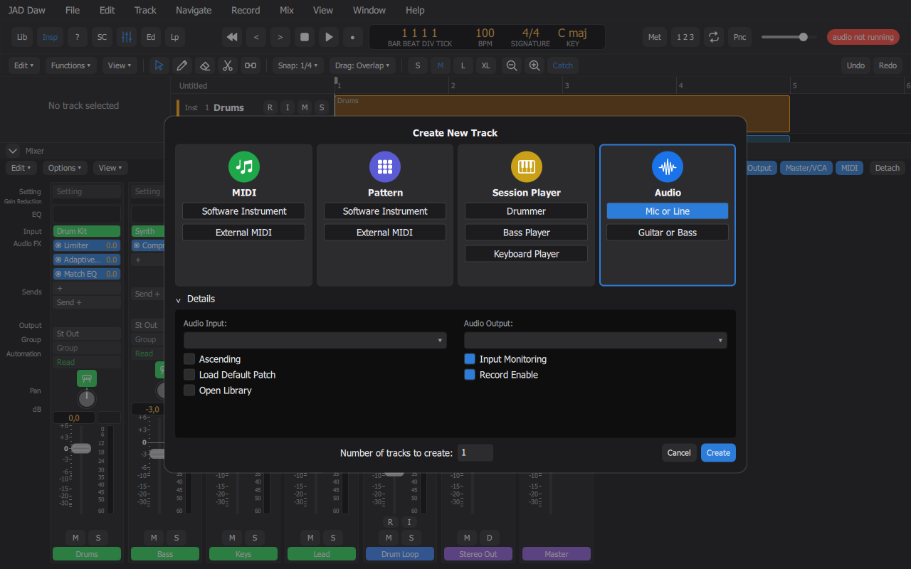

Pick a card and a kind below it, then **Details** for the input, output, monitoring and record enable, and the number of tracks.

- **MIDI**: a Software Instrument track (an instrument you hear) or an External MIDI track (the notes go out of a MIDI port).
- **Pattern**: a drum instrument track that opens in the Step Sequencer.
- **Session Player**: a Drummer, Bass Player or Keyboard Player that plays a region for you from the chords of the project.
- **Audio**: a track that records from an input, or plays audio files.

Shortcuts for the common kinds: Ctrl+Alt+A (audio), Ctrl+Alt+S (software instrument), Ctrl+Alt+X (external MIDI), Ctrl+Alt+U (session player).

## 2. The main window

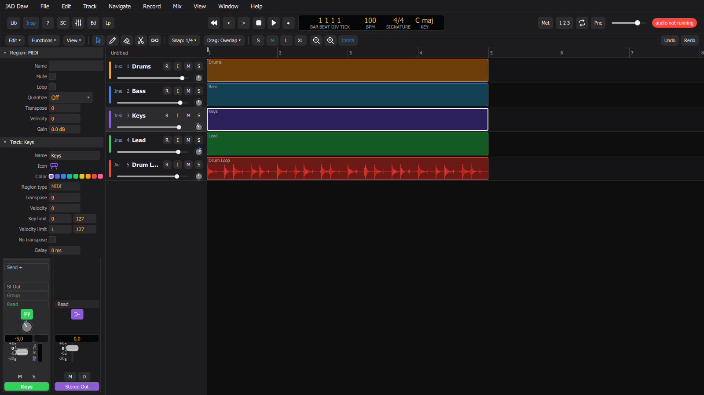

From the top:

1. **Menu bar**: File, Edit, Track, Navigate, Record, Mix, View, Window, Help. Every command in every menu comes from one table, so the
   same commands, with the same shortcuts, are available in the Key Commands window.
2. **Control bar**: the transport (rewind, back, forward, stop, play, record), the **LCD** with the position (bars, beats, divisions, ticks),
   the tempo, the time signature and the key, then Metronome (`Met`), Count-in (`1 2 3`), Cycle, and the Master volume. Double click the LCD
   values to type a new tempo or signature. The red pill says when the audio device is not running.
   On the left the panel buttons: `Lib` Library, `Insp` Inspector, `?` help, `SC` Smart Controls, the Mixer, `Ed` Editors, `Lp` Loop browser.
3. **Local toolbar**: Edit and Functions menus, the tool buttons, Snap and Drag mode, the track filters, zoom, `Catch` (the view follows the playhead), Undo and Redo.
4. **Track list and timeline** with the ruler on top. The **Inspector** on the left shows the selected region and track.
5. **Lower area**: Smart Controls, the Mixer or the Editors (Piano Roll, Score, Step Sequencer, Smart Tempo). They share the space: showing one hides the others.

Show and hide: Inspector `I`, Library `Y`, Smart Controls `B`, Mixer `X`, Editors `E`, Global Tracks `G`, Automation `A`, List Editors `D`.

**Play** with Space, **Cycle** with `C`, **Record** with `R`, **Metronome** with `K`. Return goes to the beginning, `,` and `.` to the previous and next bar,
`/` asks for a position.

**Undo** is Ctrl+Z and **Redo** Ctrl+Shift+Z. `Edit > Undo History…` (Ctrl+Alt+Z) lists every step:

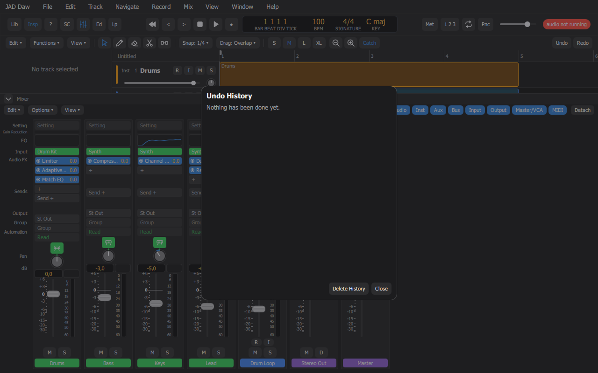

## 3. Tracks and regions

Each row of the timeline is a track. In the track header: the kind and number, the name, **R** (record enable), **I** (input monitoring), **M** (mute), **S** (solo),
the volume slider and the pan knob. Click a header to select the track (Shift or Ctrl to select more). Double click the name to rename it.
The Track menu has colour, icon, delete, stacks and alternatives; the Inspector has the same settings.

A block on the timeline is a **region**. A MIDI region holds notes, an audio region plays a part of an audio file (its waveform is drawn inside).

- **Move** a region by dragging it. **Resize** it from its edges.
- **Split** at the playhead with Ctrl+T, **join** with Ctrl+J, **duplicate** with Ctrl+D, delete with Delete.
- **Loop** a region (the `L` key) to repeat it; **mute** one with Alt+M.
- **Import audio:** `File > Import Audio File…` (Ctrl+Shift+I), or drop a file on a track. WAV, MP3, FLAC and AIFF are read and converted to the project's rate.
- **Select** with the Edit > Select commands: all (Ctrl+A), all following, inside the locators, similar and equal regions, invert, and so on.
- **Snap** (top toolbar) decides where moves and edits land. Zoom with `+` and `-`.
- **Track Stacks** (`Track > Create Track Stack…`) group tracks into a folder or a summing stack, **Alternatives** keep several versions of a track's regions.

The **Inspector** (`I`) edits the selected region (mute, loop, quantize, transpose, velocity, gain) and the selected track (name, icon, colour, transpose, velocity,
key and velocity limits, delay) above two channel strips: the track and its output.

## 4. Tools

The tool buttons in the local toolbar (or the Edit > Tool menu): **Pointer**, **Pencil** (`P`, draws an empty MIDI region or a note), **Eraser**, **Scissors** and **Glue**.

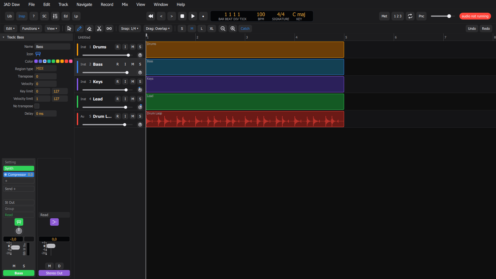

## 5. Editing notes

Open the editors with `E`. The **Piano Roll** shows the notes of the selected MIDI region on a keyboard grid, with the velocity of each note below.

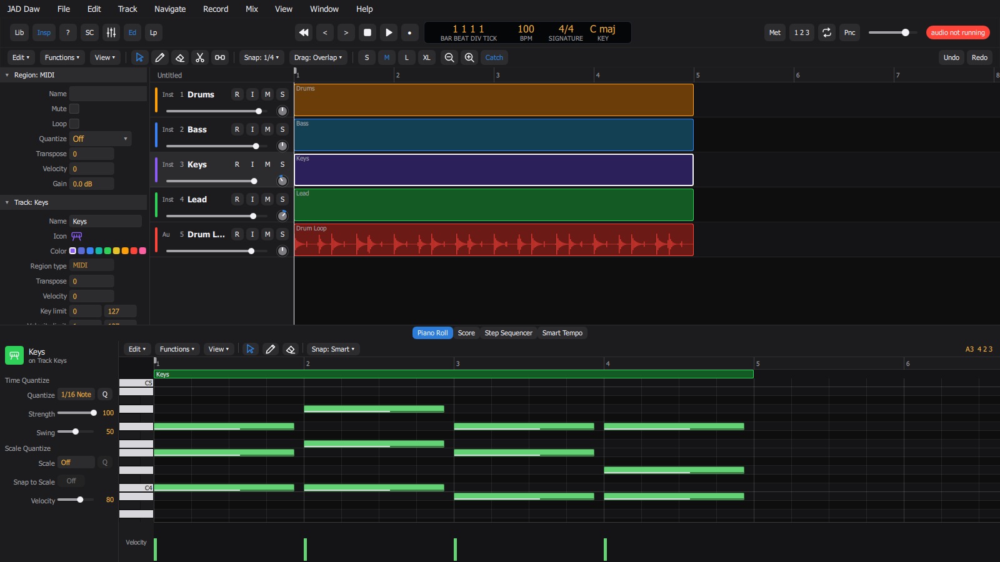

- Click a note to select it, drag to move it, drag an edge to change its length. With the Pencil tool click an empty place to add a note.
- The left column has **Time Quantize** (with strength and swing), **Scale Quantize** and the velocity the next notes get.
- **Snap** in the piano roll's own toolbar decides the grid.
- The note under the pointer is shown at the top right (note, bar, beat, division).

The other tabs: **Score** (a read-only notation view), **Step Sequencer** (a drum grid of 16th steps: click a cell to switch a step on or off) and
**Smart Tempo**. `View > List Editors` (`D`) opens the event list and the MIDI transform. For typing notes without a keyboard, open
**Musical Typing** (Ctrl+K) or the **Step Input Keyboard** (Ctrl+Alt+K):

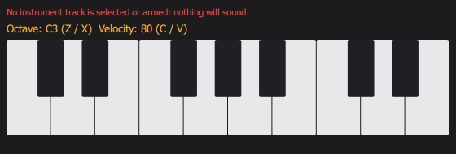

## 6. Recording

1. Set the audio device in Preferences (see [Settings](#12-settings)).
2. Click **R** on a track to arm it. For an audio track choose its input in the Inspector's strip (inputs 1-2 as a stereo pair, or one input as mono).
3. Turn on the **count-in** (`1 2 3` in the control bar) and the **metronome** (`K`) if you want them.
4. Press **Record** (`R`). Stop with Space. With Cycle on, every pass records a take; the takes of one passage are kept together and one plays.
5. **Punch In/Out** (the `Pnc` button) records only inside the punch area; `Record > Discard Recording and Return to Last Play Position` (Ctrl+.) throws a take away.

Software instrument and External MIDI tracks record what you play on a MIDI keyboard.

## 7. Library and Smart Controls

**Library** (`Y`): the patches for the selected track's kind, grouped by category, with a search box. Click one (or step with the Up and Down keys) to apply it:
the strip's values, inserts and instrument change in one undo step.

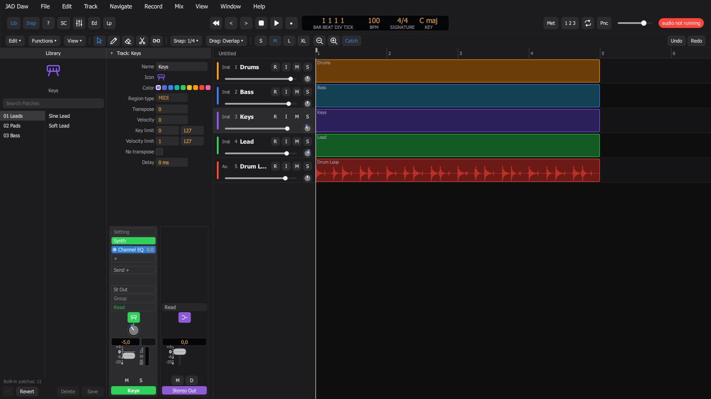

**Smart Controls** (`B`): the few controls that matter for the track's patch, grouped in panels. Drag a knob (Shift for fine steps, double click to reset).
One knob can move several parameters.

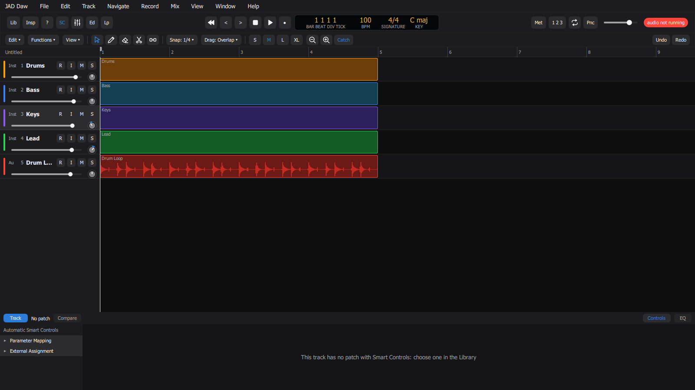

When the track has no patch with Smart Controls the area says so: choose one in the Library.

## 8. The Mixer

Open it with `X`: one strip for each track, then the output and the master.

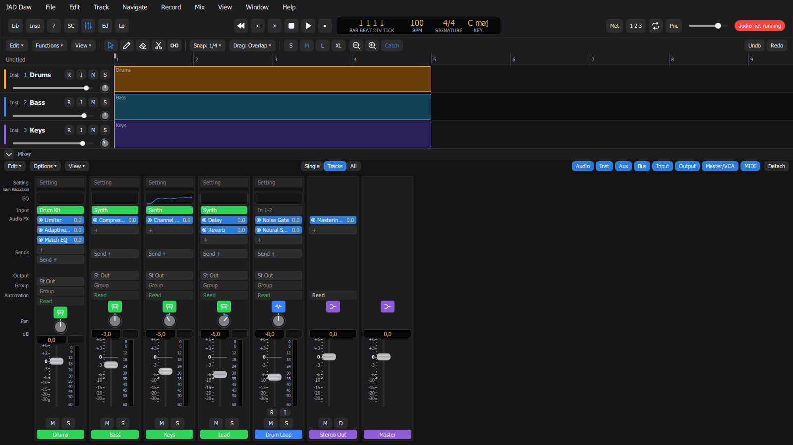

Each strip, from the top: the **Setting** slot, **EQ** (a small picture of the track's Channel EQ), **Input**, **Audio FX** (the insert slots), **Sends**, **Output**,
**Group**, **Automation** mode, the track's icon, **Pan**, the volume field (type a value), the fader with its dB scale and the level meter, then **M** and **S**
(and **R** and **I** on audio tracks), and the name bar in the track's colour.

- **Fader and pan:** drag; Option/Alt-click resets; Shift-drag moves finely. A fader is +6 dB at the top and 0 dB at 74 % of its travel.
- **Inserts:** click the empty `+` slot to add an effect. The dot on the left switches an insert off (it keeps its delay compensation so nothing shifts).
  Drag an insert up or down to reorder the chain, or onto another strip to move it there. Double click an insert to open its window.
- **Sends:** click `Send +` and choose a bus (or `New Bus`). Right-click a send to set it pre-fader.
- **Solo:** Alt-click on S solos a strip alone. A lit solo turns the playhead yellow.
- **Header:** Edit, Options and View menus; `Single | Tracks | All`; the strip type filters; `Detach` makes the Mixer a window of its own (Ctrl+2).

## 9. Plug-ins and the stock effect windows

Double click an insert, or the instrument slot, to open its window. A VST3 plug-in opens in its own window; the built-in effects and instruments have
graphical windows in the style of Logic's. Every window has the same header: power, the preset menu, Compare, Copy, Paste, Undo, Redo, and `View` (the size of the window).
The footer bar has the name; its arrow on the left switches to the plain list of parameters. Every drag is one undo step.

**Channel EQ**: eight bands (low cut, low shelf, four peaks, high shelf, high cut). Drag a band's dot for frequency and gain, scroll on it for Q.
**Analyzer** shows the spectrum before or after the EQ, **Q-Couple** makes Q follow the gain, **HQ** runs the filters at twice the sample rate, and
**Processing** sets stereo, left, right, mid or side.

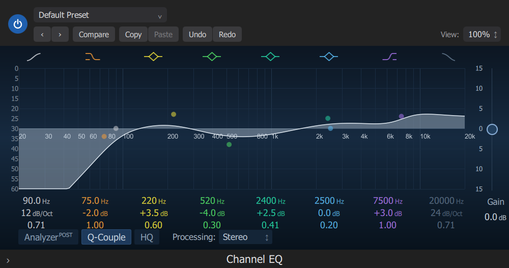

**Compressor**: seven circuit types (Platinum Digital to the vintage ones), threshold, ratio, attack, release, knee, auto gain, output distortion, a
limiter, and a side chain filter behind the `Side Chain` key. The gain reduction and the input and output meters move while it plays.

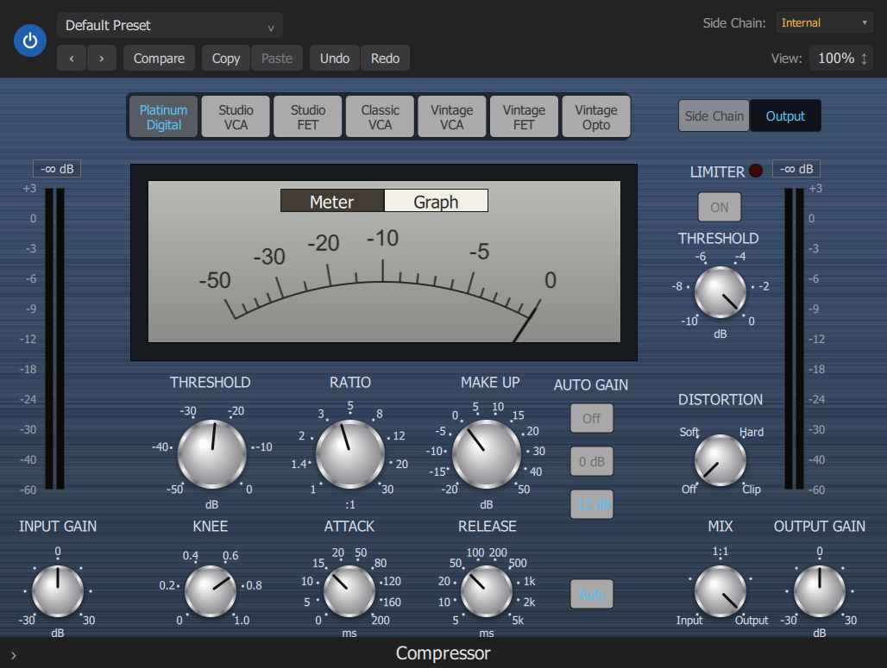

**Limiter** and **Adaptive Limiter**: gain, output level, look-ahead and release, with the input, reduction and output meters.

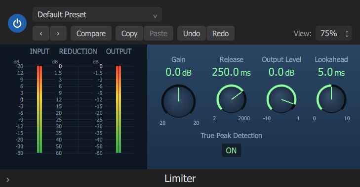

**Noise Gate**: threshold, reduction, attack, hold, release, hysteresis, look-ahead, and a side chain filter (with a Monitor to hear it).
The tabs at the top turn it into a Ducker.

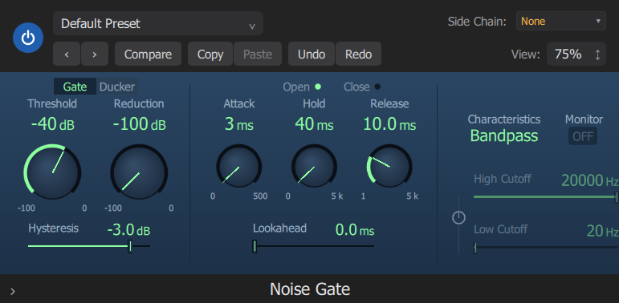

**Delay** and **Reverb**: the time or size knobs next to a picture of the echoes or the damping.

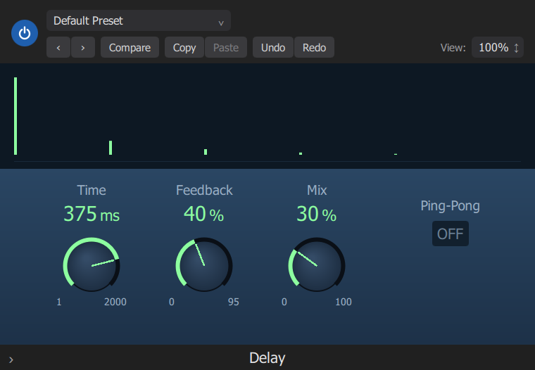

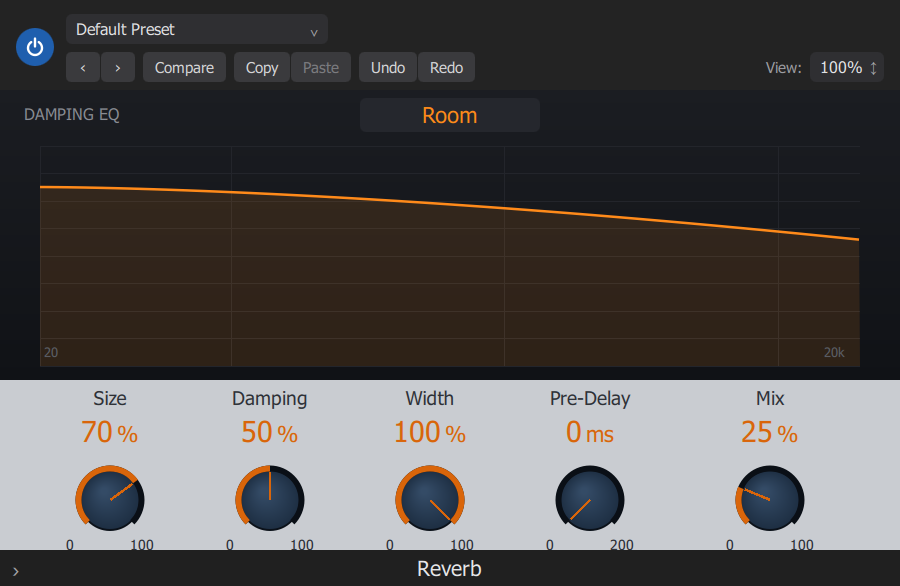

**Neural Saturation**: ten saturation models run by neural networks (on the CPU), with Drive, Output and Mix.

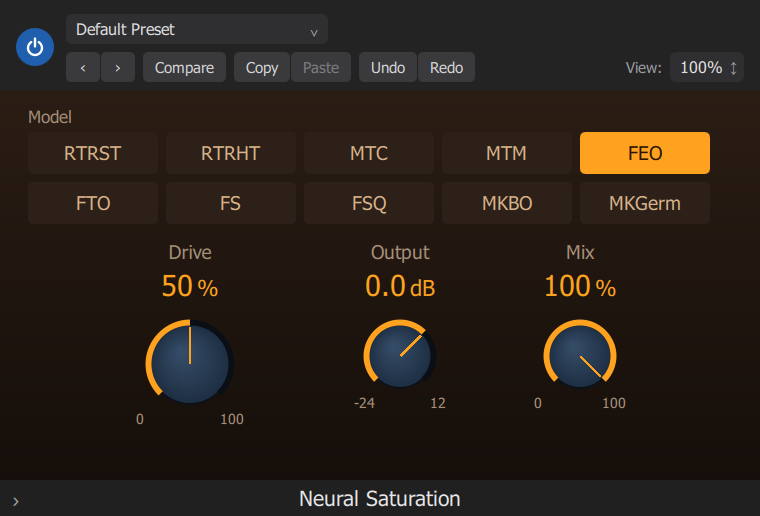

**Match EQ**: pick a reference curve, press **Match**, and the yellow curve is the correction; **Apply** scales it, the two fade sliders keep the extremes out of it.
The **Analyzer** shows what reaches the plug-in.

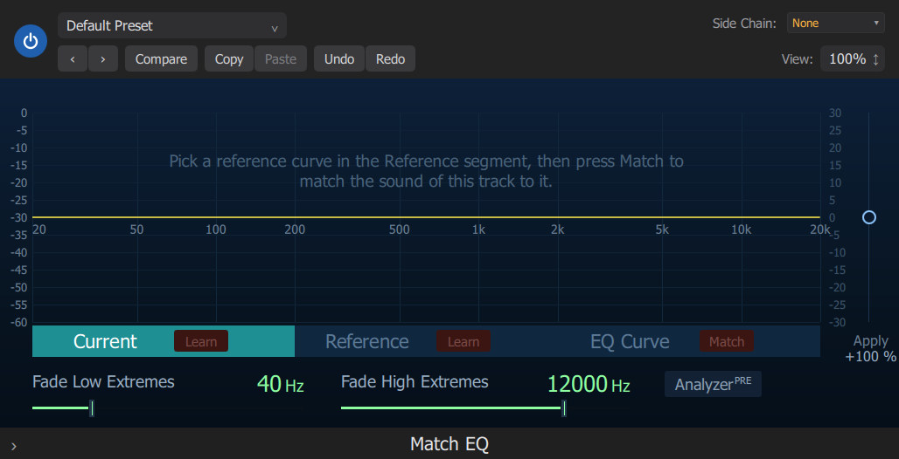

**Mastering Assistant** (on the master): play the song, press **Analyze**, and it sets an EQ curve, the loudness and the dynamics; Character picks Clean, Valve, Punch or
Transparent. The panel shows the live loudness (momentary, short-term, integrated), the true peak and the stereo correlation.

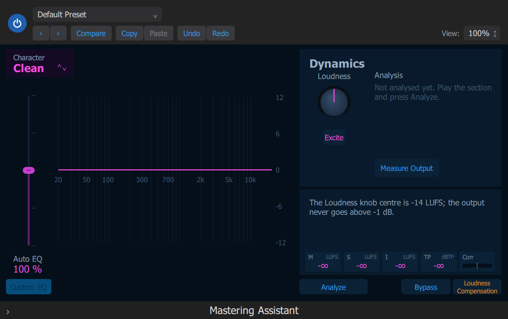

Instruments: the **Synth** (waveform, envelope, cutoff, level) and the **Drum Kit** (a pad for each drum note; press one to hear it).

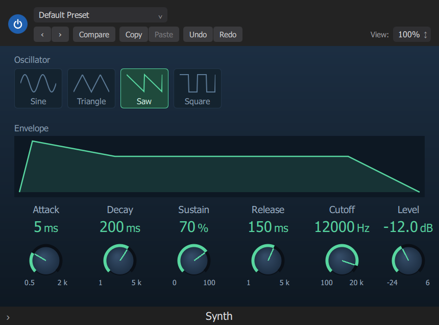

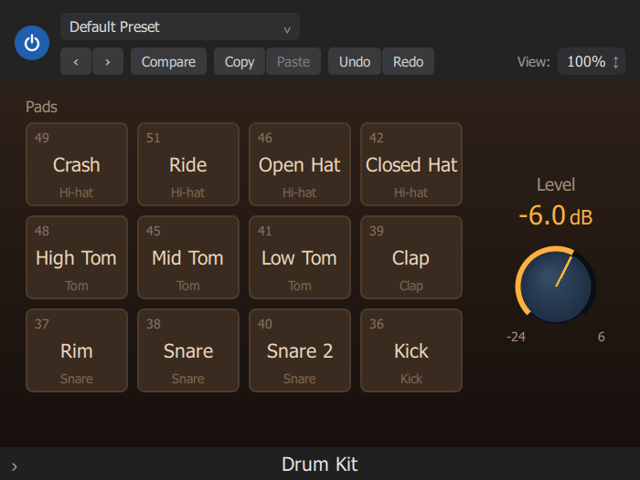

## 10. Automation and global tracks

**Automation** (`A`) shows a lane of the chosen parameter (Volume, Pan, a send, or a plug-in parameter) on each track.

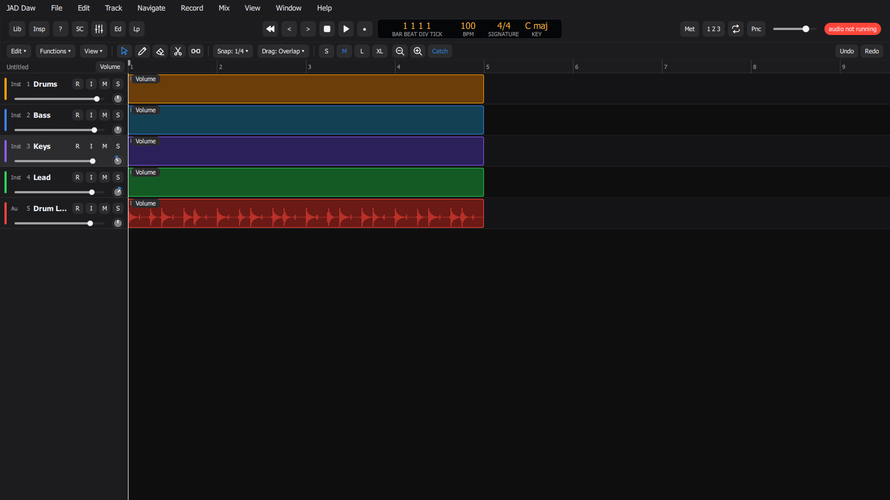

Set a track's **automation mode** in its strip: Read plays the lane back; Touch, Latch and Write record the moves of the fader and the pan while the project plays
(Touch only while the control is held, Latch from the first touch to the end, Write all the time). The `T-` and `R-` variants record a Trim or a Relative offset.

**Global tracks** (`G`) put the Arrangement, Marker, Tempo, Signature and Chord lanes above the tracks: a place to name sections, change the tempo and the meter,
and write the chords that Session Players follow.

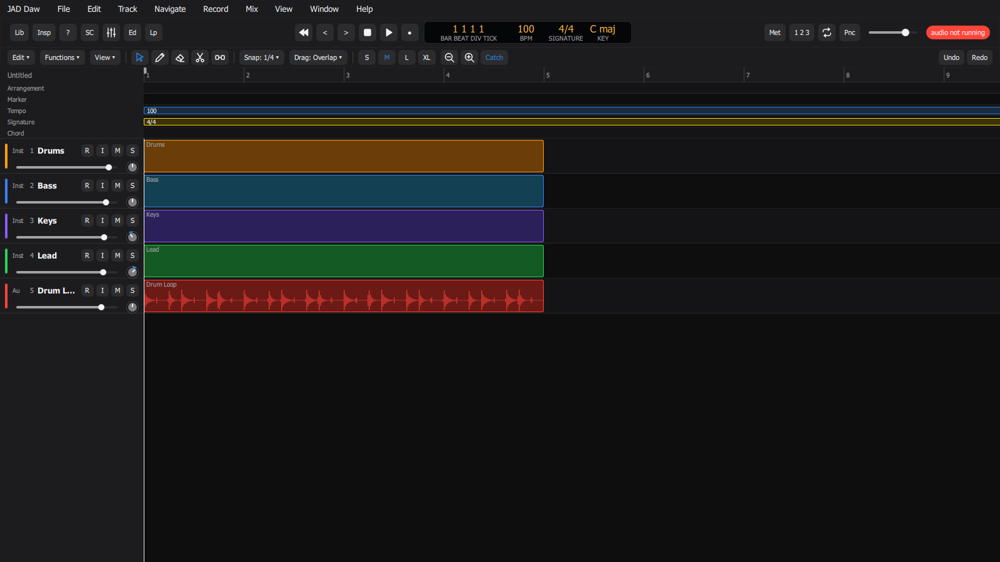

## 11. Bounce

`File > Bounce…` writes the mix to a file, faster than real time, without the audio device.

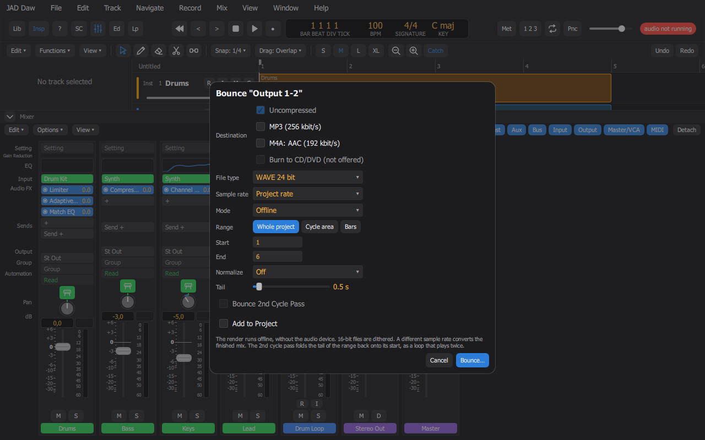

- **Destination:** uncompressed, MP3 or M4A (AAC), any of them together.
- **File type:** WAVE 16, 24 or 32-bit float; AIFF 16 or 24; CAF 16, 24 or 32-bit float; FLAC 16 or 24.
- **Range:** the whole project, the cycle area, or bars. **Tail** adds time at the end for reverbs. **Normalize** sets the peak. 16-bit files are dithered.
- **Bounce 2nd Cycle Pass** folds the tail of the cycle back onto its start, as a loop that plays twice. **Add to Project** imports the file on a new track.

## 12. Settings

**Preferences** (Ctrl+,) has General, Audio, MIDI, Display and Advanced sections. Audio is where you choose the output and input devices, the buffer size and a
recording delay:

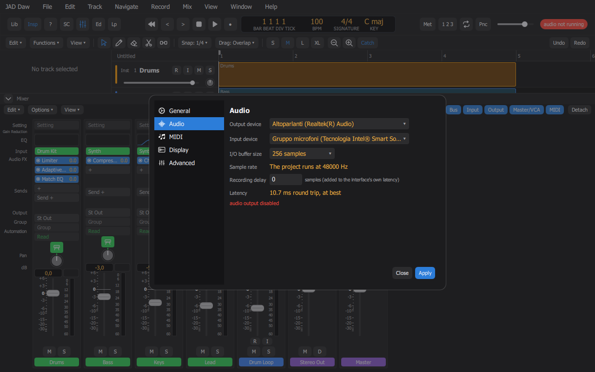

**Project Settings** are saved in the project: Audio (the pan law), Recording, MIDI, Metronome (the Klopfgeist click and the MIDI click), Assets and more.

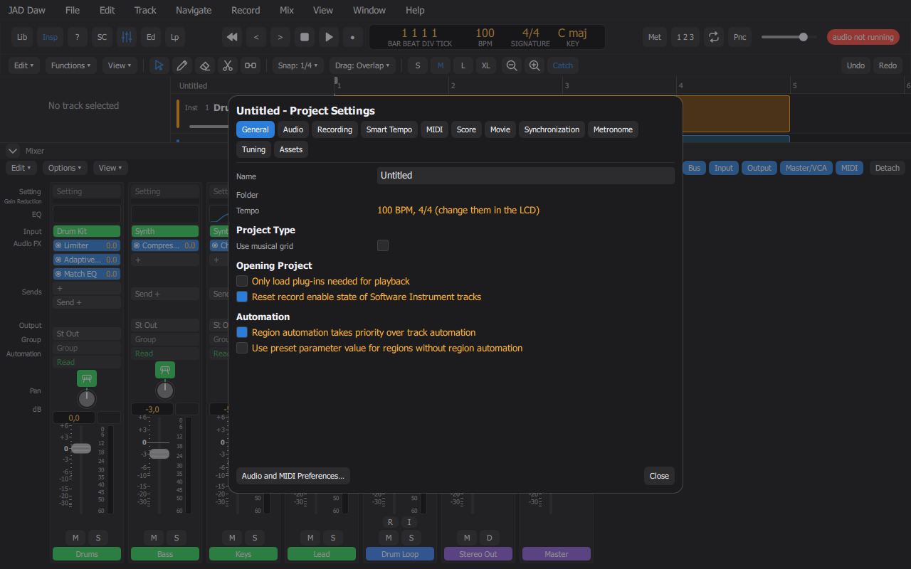

**I/O Labels** (`Mix > I/O Labels…`) gives names to the inputs, outputs and buses; the Input and Output menus show them.

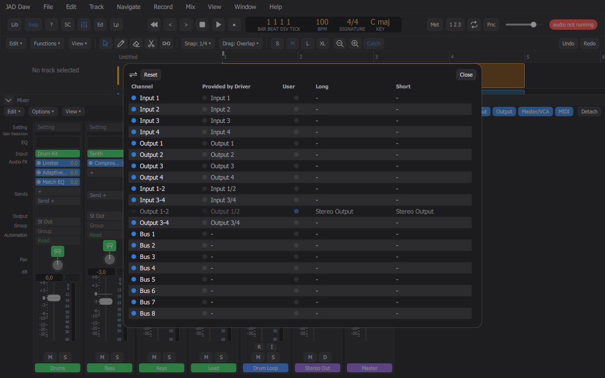

**Session Players** make a region for you from the project's chords:

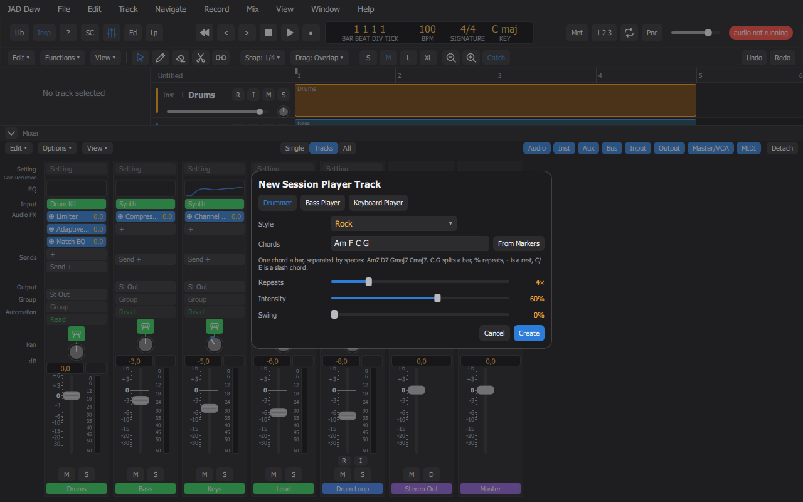

## 13. Key commands

`Alt+K` opens the Key Commands window: every command, its menu and its shortcut. Type in the search field to filter; click a shortcut to record a new one;
`Reset All` goes back to the defaults.

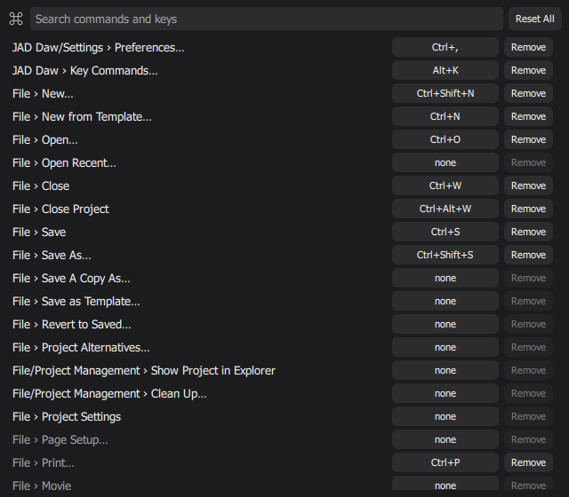

Useful ones, beyond those above: Ctrl+X/C/V cut, copy, paste; Ctrl+Shift+V paste replacing; `H` hides a track; `Alt+'` creates a marker; `U` sets the locators from
the selection and turns Cycle on; `V` shows all plug-in windows; `Ctrl+1` to `Ctrl+9` open the main window, the Mixer, Smart Controls, the Piano Roll, the Score, the
Audio File Editor, the Event List, Project Audio and MIDI Transform in windows of their own.

The menus are laid out as in Logic:

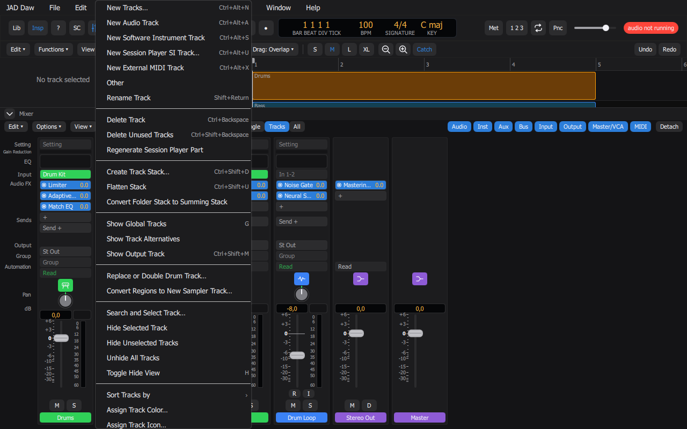

---

## What is not there yet

Some menu commands are present but say "not implemented yet" when chosen: printing and page setup, the Movie window, Dolby Atmos, the Mac window sets,
conversion of regions to a Sampler track, Live Loops. A few settings are saved with the project but do not change the sound yet: region automation
priority, loading only the plug-ins needed for playback, copying assets on import. There is no region automation (only track automation).
The Custom EQ and Spread of the Mastering Assistant, and the live spectrum of the reference in Match EQ, are missing. The plug-in windows
of the stock effects are our own drawings in Logic's style, not Apple's. The file [docs/roadmap-autonomous.md](roadmap-autonomous.md) keeps the full list.
